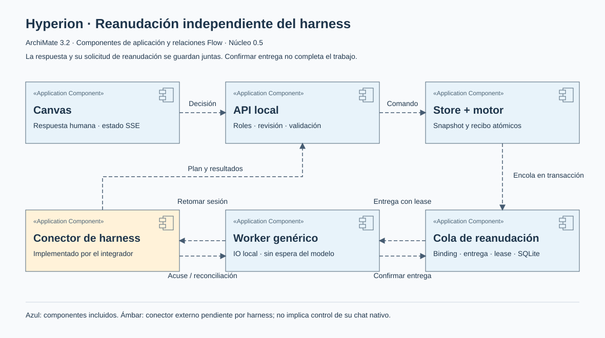

# Pausa y reanudación

Hyperion guarda el proceso aunque el chat termine su turno. Para retomarlo al recibir una respuesta necesita un **conector de reanudación** de la herramienta elegida.

La versión 0.5 del código incluye el protocolo, la cola persistente y un worker común. Los conectores nativos para reactivar sesiones de cada proveedor todavía no se incluyen. Los instaladores de la release preliminar tampoco contienen estos cambios de `main`.

<GuideLens kind="resume" />

## Cómo se verá

1. Pides «Usa Hyperion para preparar una guía de bienvenida a mi proyecto».
2. El agente genera el flujo y pregunta en el canvas solo lo que falta.
3. Con un conector instalado, guarda la pausa y cierra su turno.
4. Al guardar tu respuesta, Hyperion solicita al conector que retome el trabajo.
5. El agente lee tus datos y actualiza tareas, resultados y logs.

El canvas distingue **Reanudación pendiente**, **Conector retomando** y **Solicitud entregada al agente**. Una solicitud entregada todavía no significa trabajo ejecutado. Si la entrega es incierta, se verifica antes de repetirla.

## Qué necesita cada herramienta

| Herramienta    | Situación actual                                                                                                         |
| -------------- | ------------------------------------------------------------------------------------------------------------------------ |
| Codex          | MCP/skill local disponible. Conector de reanudación vía App Server pendiente.                                            |
| ChatGPT        | Requiere integración remota autenticada y eventos; pendiente. No conecta al MCP stdio de tu equipo.                      |
| Claude Desktop | MCP local disponible. Sin wakeup del mismo chat verificado.                                                              |
| Claude Code    | MCP/skill disponible. Conector de sesión Agent SDK pendiente.                                                            |
| Cursor         | MCP/skill disponible. Conector de sesión CLI pendiente.                                                                  |
| Hermes Agent   | MCP stdio configurable. Conector de sesión persistida pendiente.                                                         |
| Antigravity    | MCP y asistente Desktop en `main` (no preview 0.4.0). Sin validación en cliente real; conector de reanudación pendiente. |

Si ves **Continuar desde el chat**, la respuesta ya está guardada pero no hay un conector de reanudación asignado. Reintentar no crea un agente ni abre un chat por sí solo.

Sin ese conector, la integración usa la espera cooperativa: puede continuar mientras el chat mantiene la llamada abierta. La llamada guiada espera como máximo diez minutos; al terminar, informa la desconexión una sola vez. Renovar esa espera indefinidamente no crea ejecución en segundo plano. No se debe prometer que instalar MCP basta para despertar un chat cerrado.

La identidad del harness no altera las reglas del workflow. La referencia de sesión y las capacidades pertenecen al conector, que debe respetar permisos y evitar turnos duplicados.

[Contrato, fuentes oficiales y pruebas del protocolo](https://github.com/0vas/hiperion/blob/main/docs/continuacion-agnostica.md).
