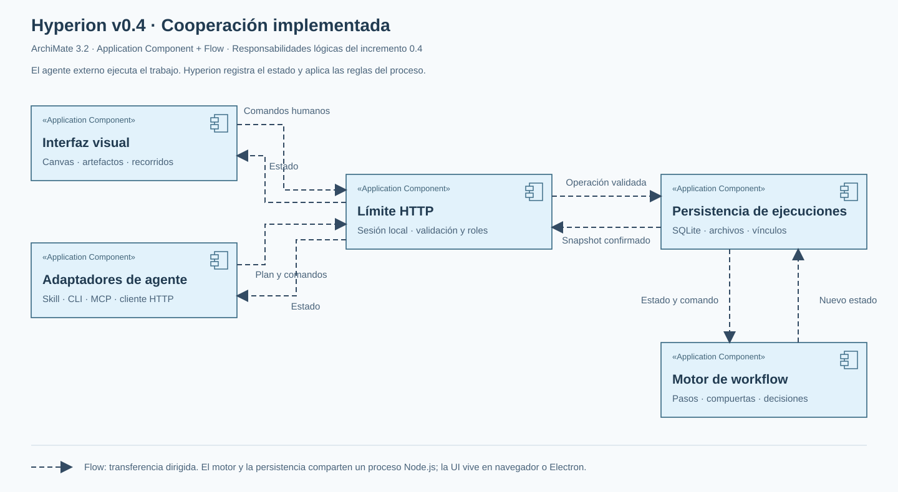

# Arquitectura

**De una conversación a trabajo visible.** El agente ejecuta, tú decides y Hyperion mantiene el estado y la evidencia.

## De la petición al resultado

<ArchitectureAtlas />

## Dentro de Hyperion

Tres vistas del mismo sistema. Selecciona una y abre Archify para explorar los componentes a pantalla completa.

<Architecture />

## Despliegue y límites de confianza

<ArchitectureAtlas kind="deployment" />

Desktop también comprueba releases de GitHub y descarga instaladores tras confirmación, validando tamaño y SHA-256. La integridad ad-hoc de macOS no equivale a notarización. [Decisión de distribución y actualizaciones](https://github.com/0vas/hyperion/blob/main/docs/decisions/0031-desktop-integrity-and-updates.md).

::: info Lo que está disponible
Motor, canvas, persistencia y cola de reanudación implementados. Retomar un chat cerrado requiere un conector real instalado; los conectores nativos siguen pendientes.
:::

Profundizar: contratos, responsabilidades, fallos y modelos ArchiMate

## Qué hace Hyperion

| Capacidad                     | Cómo se materializa                                                        | Qué ve la persona                                |
| ----------------------------- | -------------------------------------------------------------------------- | ------------------------------------------------ |
| Dar estructura a una petición | El agente registra la petición, el plan, los trabajos y sus pasos          | Un objetivo compartido y un recorrido navegable  |
| Guiar trabajo y decisiones    | El motor valida dependencias, roles y respuestas                           | Qué está listo, quién actúa y qué falta          |
| Coordinar ramas               | El perfil BPMN-lite resuelve compuertas paralelas, exclusivas e inclusivas | Caminos seleccionados, omitidos y pendientes     |
| Hacer viajar los datos        | Contratos tipados conectan contexto, entradas y salidas                    | De dónde sale cada dato y qué produce cada tarea |
| Mostrar evidencia             | Eventos, resultados y trazas públicas acompañan a cada paso                | Actividad, I/O, fallos e intentos                |
| Adaptarse a una conversación  | Las revisiones proponen cambios de trabajo futuro y conservan historia     | Cambios de plan que requieren revisión           |
| Recuperar continuidad         | Respuestas persistidas, retry y cola de reanudación                        | Estado real de la tarea y del relevo al agente   |

La orquestación multiagente autónoma sigue siendo una extensión. El paralelismo del proceso ya existe; no implica que Hyperion seleccione y arranque varios modelos por su cuenta.

## Un recorrido concreto

> «Usa Hyperion para preparar una guía de bienvenida a mi proyecto».

1. **Petición → plan.** El harness genera el plan y declara solo las preguntas que faltan. CLI o MCP lo envían al servicio HTTP local.
2. **Plan → trabajo habilitado.** El motor comprueba estructura y dependencias. El canvas muestra el mismo run que consulta el agente.
3. **Persona → salida.** La persona elige la audiencia. El formulario nace del contrato; una lista de opciones permite elegir sin adivinar qué escribir.
4. **Salida → entrada.** El borrador referencia la audiencia elegida. El agente lee los datos actualizados, inicia la tarea y registra un resultado real.
5. **Resultado → revisión.** La persona revisa el borrador. Una aprobación no publica ni envía nada si ese trabajo no forma parte del alcance.
6. **Cierre → evidencia.** El proceso conserva respuestas, resultados, eventos e intentos para explicar cómo llegó al resultado.

::: info Estado compartido
La conversación aporta intención. El run persistido aporta el estado operativo. Una etiqueta «listo» habilita una tarea; no demuestra que el agente ya la esté ejecutando.
:::

## Responsabilidades y código

| Límite           | Responsabilidad                                                                  | Fuente                                                                                                                                                                 |
| ---------------- | -------------------------------------------------------------------------------- | ---------------------------------------------------------------------------------------------------------------------------------------------------------------------- |
| Harness externo  | Interpretar la petición, proponer pasos, usar herramientas y reportar resultados | [Contrato de integración](https://github.com/0vas/hiperion/blob/main/docs/integration.md)                                                                              |
| Adaptadores      | CLI y MCP comparten un cliente HTTP; descubrimiento y arranque local             | [src/adapters](https://github.com/0vas/hiperion/tree/main/src/adapters)                                                                                                |
| API local        | Autenticar identidades, diferenciar roles y exponer comandos/lecturas/SSE        | [app.ts](https://github.com/0vas/hiperion/blob/main/src/server/app.ts)                                                                                                 |
| Motor de dominio | Transiciones, dependencias, compuertas, contratos y revisiones                   | [src/domain](https://github.com/0vas/hiperion/tree/main/src/domain)                                                                                                    |
| Store y cola     | Snapshot, recibos idempotentes y entregas persistidas en SQLite                  | [store.ts](https://github.com/0vas/hiperion/blob/main/src/server/store.ts), [continuations.ts](https://github.com/0vas/hiperion/blob/main/src/server/continuations.ts) |
| Canvas           | Representar el estado, recoger decisiones y mostrar actividad por paso           | [src/client](https://github.com/0vas/hiperion/tree/main/src/client)                                                                                                    |
| Desktop          | Alojar el canvas, iniciar/reutilizar el servicio y facilitar la conexión         | [desktop](https://github.com/0vas/hiperion/tree/main/desktop)                                                                                                          |
| Worker opcional  | Recoger entregas y delegar la reanudación en un conector instalado               | [continuation-worker.ts](https://github.com/0vas/hiperion/blob/main/src/adapters/continuation-worker.ts)                                                               |

Son límites de responsabilidad; no son ocho microservicios desplegados por separado.

## Datos, contratos y evidencia

**Plan → run → pasos → intentos y eventos.** El plan contiene la petición, contexto, trabajos, dependencias y contratos. El run añade estado, revisión y resultados. Los trabajos agrupan pasos y derivan su progreso; no duplican el motor de ejecución.

Una entrada puede tomar un literal, una clave del contexto o una salida de otra tarea. El motor valida tipo y obligatoriedad. El contexto disponible también muestra resultados de antecesores completados, pero no sustituye las entradas requeridas.

| Dato                       | Función                                                       |
| -------------------------- | ------------------------------------------------------------- |
| `plan.request` y contexto  | Conservar la intención y antecedentes del trabajo             |
| Entradas / salidas tipadas | Definir qué necesita y produce cada paso                      |
| Revisión del run           | Rechazar respuestas basadas en un estado desactualizado       |
| ID de comando y recibo     | Evitar duplicados cuando se repite una petición de transporte |
| Eventos y trazas           | Registrar resúmenes públicos, acciones y observaciones        |
| ID de entrega y lease      | Coordinar el relevo a un conector y reconciliar incertidumbre |

SSE actualiza el canvas; el sondeo de respaldo recupera cambios cuando hace falta. Los logs reflejan lo que el agente reporta. No son acceso al razonamiento privado del modelo ni una verificación independiente de todos sus efectos externos.

## Pausa, fallos y cambios de plan

| Situación                                 | Respuesta de la arquitectura                                                                   |
| ----------------------------------------- | ---------------------------------------------------------------------------------------------- |
| Falta una respuesta humana                | El sucesor permanece bloqueado; la respuesta y su revisión se validan antes de avanzar         |
| El chat conserva una llamada abierta      | La integración cooperativa puede leer el cambio y continuar                                    |
| Hay suspensión y conector instalado       | La respuesta guarda estado, recibo y entrega en una transacción; el worker recoge la solicitud |
| El conector confirma entrega              | Se confirma el despacho; el agente aún debe iniciar y reportar el trabajo                      |
| Se pierde el acuse o vence el lease       | Se exige reconciliar antes de reenviar; podría haber empezado un turno                         |
| Falla una tarea o queda un intento activo | Retry/recuperación conservan evidencia; hay que comprobar efectos externos antes de repetir    |
| Cambia el objetivo durante el chat        | La revisión de trabajo futuro conserva historial y pausa para revisión humana                  |

::: warning Límite actual de integración
El núcleo 0.5 incluye suspensión, cola persistente y worker genérico. Los conectores nativos de reanudación siguen pendientes. MCP por sí solo no despierta una conversación cuyo turno terminó. Consulta [Pausa y reanudación](../guia/reanudacion.md) para distinguir las capacidades disponibles.
:::

## Detalles de despliegue

**Equipo local:** harness → CLI/MCP → HTTP en loopback → motor + SQLite. El navegador o Electron muestran el canvas de ese servicio. Los procesos de presentación no mantienen una copia independiente del motor.

**GitHub Pages:** documentación, diagramas y simulaciones estáticas. Pages no ejecuta el servicio de workflows ni instala un agente. El sitio y el runtime tienen ciclos de publicación diferentes.

**Integración de reanudación:** un módulo local de confianza conecta el worker con una sesión real del harness. Se configura fuera de los planes generados y conserva los permisos normales del host.

La sesión humana y las identidades de agente tienen permisos distintos. Tokens, referencias de sesión y datos locales no deben publicarse en ejemplos, diagramas o logs compartidos. La edición local no incorpora un servicio multiusuario remoto con autenticación y aislamiento; conectar una aplicación en la nube exige ese trabajo adicional.

## ArchiMate y decisiones

Archify permite explorar las vistas. ArchiMate conserva los modelos formales de componentes y relaciones. BPMN-lite representa el proceso ejecutado; no sustituye a ArchiMate ni afirma conformidad con BPMN 2.0 completo.

Ver las vistas formales de componentes y reanudación

[Modelos XML y vistas SVG](https://github.com/0vas/hiperion/tree/main/docs/architecture) · [Decisiones de arquitectura](https://github.com/0vas/hiperion/tree/main/docs/decisions). Los modelos tienen referencias XML comprobables; no se afirma una validación XSD o importación formal que no se haya realizado.

## Cómo se mantiene verificable

- **Motor y datos:** pruebas de dominio, procesos, contexto y formularios validan contratos y rutas.
- **Persistencia y recuperación:** pruebas de store, HTTP y continuidad cubren reinicio, duplicados y entrega ambigua.
- **Experiencia:** Playwright comprueba decisiones, navegación y simulaciones. Un conector de prueba no certifica un harness real.
- **Documentación:** cada cambio de contrato, conexión o componente debe actualizar sus guías ES/EN, diagramas y ejemplos en el mismo cambio.

[AGENTS.md](https://github.com/0vas/hiperion/blob/main/AGENTS.md) recoge el mapa del proyecto, las invariantes y la matriz de actualización documental. [Contrato de procesos](https://github.com/0vas/hiperion/blob/main/docs/process-contract.md) detalla el formato ejecutable.

## Del resultado al siguiente recorrido

En el explorador Archify, abre **Datos y decisiones** para seguir el resultado del paso hasta el nuevo ciclo.

El registro del artefacto, su evento y el recibo se guardan en una transacción. El agente coordinador registra el resultado; el canvas lo consulta con su sesión. Los bytes permanecen separados del snapshot y los formatos activos no se ejecutan al previsualizar. Los límites y permisos se aplican en la API y el dominio.

El vínculo de conversación se guarda en `run_links` y se proyecta en ambos recorridos. El padre mantiene su snapshot; el hijo recibe una referencia de origen y contexto relevante declarado por el agente. La conexión visual queda fuera del DAG ejecutable y no activa un conector ni reabre trabajo terminado. [ADR 0033](https://github.com/0vas/hyperion/blob/main/docs/decisions/0033-artifacts-and-linked-cycles.md).
